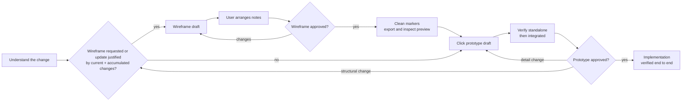

# UI/UX Design Workflow

A reusable workflow for reviewing structure and behavior before application
implementation, independent of product domain and frontend framework. Each
project supplies a profile with its paths, roles, languages, viewports, tools
and runtime helpers.

## Before You Start

1. Load the project profile: the file linked from the project's agent
   instructions, otherwise the project file in `references/` (exclude the shared
   `project-profile.md`, `drawio-conventions.md` and `design-system.md`).
   If several project files exist, ask which applies rather than guessing.
   If none exists, follow [Set up a project](#set-up-a-project); never treat a
   shared contract as a configured project profile.
2. Read the project's decision records and design index named in the profile.
   Project decisions override the profile; the profile overrides the defaults
   in this skill ([precedence](references/project-profile.md#precedence)).
3. Before any design work, including direct prototype and small-change paths,
   read the profile's design guide and applicable component/pattern notes, then
   inspect the affected view's existing prototype and nearby application
   implementation (or the closest analogous view for new work). Read relevant
   shared helpers and a usage example from the profile's inventory before
   extending or replacing them. Keep reading scoped to the change; when a
   baseline is absent, record the gap rather than assuming a new convention.
4. Consult relevant optional business-context sources linked by the profile,
   such as domain stories, journey maps or workshop notes, for both wireframe
   and prototype work. Use actors, activities, work objects, handoffs and
   outcomes to inform design; cite the source and relevant activities in the
   artifact's notes. Preserve source ownership and review status. These inputs
   do not replace requirements or decisions; surface conflicts rather than
   inventing policy. Their absence does not block design: do not require their
   creation, a workshop or a separate approval gate.
5. Preserve existing conventions and user edits; do not import another
   project's choices.

## Choose the Path

| Request | Go to |
| --- | --- |
| New view or structural change | [Understand](#1-understand-the-change); choose wireframe or direct prototype by review value |
| Revise wireframe notes | [Wireframe](#2-wireframe), [annotation scopes](#annotation-scopes) |
| Notes arranged by the user | Run [source checks](references/drawio-conventions.md#source-checks); present the source for review |
| Wireframe approved | [Cleanup and export](#drawing-and-review), then [record approval](#6-finish) |
| Small layout adjustment, interaction, state or text detail | [Click prototype](#3-click-prototype), [Verify](#5-verify) |
| Prototype approved | [Record approval](#6-finish); hand off for implementation |
| Color, typography, spacing or component pattern | [Design system](#4-design-system), [Verify](#5-verify) |
| No design setup or profile yet | [Set up a project](#set-up-a-project) |

## Workflow Overview



Artifact status: `draft` → `in review` → `approved`. Any change to an approved
artifact returns it to `draft`.

## Explicit Approval Gates

Default rules; a project's decision records may strengthen or override them.

- Only explicit user approval of a named artifact's current revision counts.
  Feedback, requested corrections, arrangement confirmation, policy acceptance,
  "proceed" and passing checks are not approval.
- Earlier approvals remain history and never carry over to a changed revision.
- When a wireframe is created or changed for this change, require its approval
  and cleaned, inspected preview before the prototype. Skipping a low-value
  wireframe update does not require wireframe approval. Always require prototype
  approval before implementation. Both named current artifacts may be approved together.
- Before each dependent step, check the design index for the prerequisite's
  approval. Present drafts with verification evidence. After corrections,
  verify and return the draft; do not repeatedly prompt for approval or continue
  dependent work while review is pending.

## Set up a project

### Repository integration

- Install the shared skill, references and starter assets in the agent's supported
  skill directory, such as `.github/skills/ui-ux-design/` or `.agents/skills/ui-ux-design/`.
  Keep this reusable bundle project-neutral; do not copy another project's profile.
- Keep exactly one project profile at `references/<project>.md` inside the skill.
  The shared `references/project-profile.md` is the contract/template, not a
  configured profile. Keep design artifacts and the design index in project
  documentation, linked from this profile; do not duplicate the profile there.
- In the repository's `AGENTS.md`, `.github/copilot-instructions.md` or equivalent
  agent instructions, link both the skill and the chosen profile explicitly and
  require reading them together. That link is the primary discovery route; the
  skill's `references/` lookup is only a fallback. Keep repository-specific links
  out of the shared skill.
- Ask the agent to "set up the design workflow" using the steps below. Reuse an
  existing profile, design index, design system and prototype runtime; starter
  assets are only for missing foundations, never replacements for existing work.
- Verify that the agent-instruction links resolve and the profile identifies the
  actual project resources. Keep existing artifact revisions and approvals intact.

### Setup steps

1. Detect existing design artifacts, decision records, tokens, prototype runtime
   and implementation conventions.
2. Update the existing profile, or create one from the [profile template](references/project-profile.md#profile-template).
   Ask for business-relevant values such as roles, languages and approval rules;
   never invent them.
3. Reuse the existing design index, or create one with the [required fields](references/project-profile.md#design-index-fields).
4. When a wireframe adds review value, start it from the [template](assets/wireframe-template.drawio).
5. Create a minimal offline prototype runtime when the requested work needs it.
   If the project has no design system, start one from the
   [design-system starter](assets/design-system/) following the
   [design-system contract](references/design-system.md).
6. Link the profile from the project's agent instructions.

## 1. Understand the change

1. Read the design index and any existing wireframe and prototype for the view. An existing preview may show an older revision and is not the current draft.
2. Read the applicable decisions and requirements (business rules, permissions, localization, accessibility). Do not invent business rules; ask when a policy is unclear.
3. Decide which artifacts change:

| Change | Wireframe | Prototype | Design system |
| --- | --- | --- | --- |
| New view | Create when rough layout review adds value; PNG after approval | New page | Only if new patterns are needed |
| Substantial layout, sections, navigation, new controls | Create/update when structural review adds value | Update | — |
| Small layout adjustments, validation, states, texts, dialog details, interaction | May skip only while the cumulative mismatch remains minor | Update | — |
| Colors, typography, spacing, component pattern | — | Update affected pages | Update tokens and guides |
| Shell (toolbar, navigation, user menu) | Apply the same review-value decision to the shell wireframe | Shared shell prototype | If tokens change |

Use a wireframe first when agreeing on structure, navigation, hierarchy or a
workflow would materially help review. For smaller changes, or a clear layout
where a wireframe adds little value, start directly with the prototype. Do not
require a drawing update solely because a wireframe exists. State the chosen
path and why; ask only when the review value or scope is unclear. This choice
does not bypass an already pending wireframe review or explicit user request.

Before each decision to skip, compare the wireframe with the current prototype
and proposed change, including all previously skipped changes. Judge their
cumulative effect, not just the size of the latest change. Once the accumulated
mismatch justifies an adjustment, updating the wireframe is mandatory and cannot
be skipped again. Reconcile the affected drawing and notes with the combined
changes, obtain explicit approval, then clean, export and inspect its preview
before proceeding with the prototype change. Resolve the recorded mismatches
only after they have been incorporated; retaining a stale-reference note is not
a substitute for this required update.

If an existing wireframe is not updated and no longer matches the prototype,
record the mismatch and affected scope in the design index or artifact README,
linking the newer prototype revision. Preserve the earlier wireframe approval
as history for that revision; do not present it as an accurate, approved
representation of the changed design. Unaffected wireframes need no status change.

## 2. Wireframe

- Wireframes are always draw.io sources (`.drawio`); projects do not choose another tool. Use one source per substantially different view layout, with one desktop main-content viewport at the profile's width. Keep shared shell chrome in its own wireframe. Start from the [template](assets/wireframe-template.drawio) and follow the [draw.io conventions](references/drawio-conventions.md); a profile may override only their house-style values.
- Write all wireframe text in English, including UI labels, placeholders, notes and connector labels. Product localization applies to prototypes and the application, not wireframes.
- For each note, ask whether the detail affects what users see or can do, or is needed to decide the layout. Keep only that key behavior or critical constraint, briefly. Detailed interactions, validation, errors and edge cases belong in the prototype; enduring business and security rules belong in authoritative decisions. Do not discard requirements when shortening notes.
- Omit notes that merely describe what the drawing already shows, such as a visible tab, even after a change.

### Annotation scopes

- Put conditional details under short, bold bracketed scope headers on their own lines, with the detail below.
- Adjacent brackets mean every condition must apply: `[role: manager][state: retired]` applies only to managers viewing a retired item. Add more conditions the same way, such as `[role: manager][state: retired][device: phone]`.
- Write attributes in the profile's order (default: role, state, device or viewport). Do not split one combined condition across headers or put several attributes in one bracket.
- Use separate sections for differing behavior. `[roles: manager, member]` marks a detail shared by either listed role, not both at once.
- Use the profile's scope vocabulary; names and values here are examples, not a closed list.
- Introduce a new attribute when a detail genuinely varies along another dimension, such as `direction: rtl`, `language: ar` or `theme: dark`. Choose a short lowercase name, add it with its values and position in the order to the profile's vocabulary, and reuse it consistently. Take business values such as roles or domain states from requirements; never invent them to justify an attribute.
- Put an empty line before a header that follows other text, not before the first line. General details need no header.
- Order each note: general details first, then the scoped groups. Each distinct scope combination appears at most once per note; collect all its details under that single header instead of repeating it.
- Apply the draw.io [note formatting](references/drawio-conventions.md#notes-and-connectors) for bold headers and line breaks.

Example note:

**[role: manager][state: retired]**<br>
Show the reactivation action.

**[role: manager][state: retired][device: phone]**<br>
Open confirmation full-screen.

### Drawing and review

- Consolidate notes about one area into one note with one arrow. In user-edited sources, change only affected cells.
- Mark new or changed notes with the [review marker](references/drawio-conventions.md#review-markers) instead of revision labels in their text.
- Give notes an initial non-overlapping position outside the viewport, then ask the user to arrange them in draw.io, on any side. Do not optimize or overwrite their placement. Arrangement confirmation is not approval.
- Review the draw.io source, never a preview, while the wireframe is a draft. Do not export during creation, revision or arrangement; identify any existing preview as potentially stale. Run the [source checks](references/drawio-conventions.md#source-checks) before presenting the draft.
- After explicit approval, apply the [cleanup](references/drawio-conventions.md#cleanup-after-approval), then [export](references/drawio-conventions.md#export) and view the preview without waiting for a separate request.
- Do not record cleanup as complete or advance to the prototype if export or inspection is blocked. If inspection reveals a design flaw, correct the source and return the new revision for approval.

## 3. Click prototype

- Build an offline prototype from requirements and existing design references, using the approved wireframe when one is part of this change. Use the profile's shared shell, components, formatting helpers, tokens and fictional data. Keep assets local; reuse existing helpers rather than creating parallel ones.
- Maintain an integrated application entry that composes the existing views, not a specimen gallery. Keep standalone views usable, the directly opened shell neutral and chrome unduplicated. Preserve role, language, theme and fictional data through actual navigation. Keep implementation notes outside the review surface.
- Demonstrate loading, empty, error/retry, validation, submitting, success and failure with retained input where applicable, plus the profile's permissions, languages, themes and breakpoints.
- Prototypes illustrate behavior; they do not enforce security or define business rules.

## 4. Design system

The project's design system lives where the profile's *Design tokens* setting
points. Follow the [design-system contract](references/design-system.md) for its
required parts, token layers and rules.

- Change shared semantic tokens rather than adding color or size literals. Provide values for every supported theme and document contrast for new color pairs.
- Pair status with icon and text cues; keep visible focus and accessible names.
- Update the affected guides and specimens, then work through the contract's [change checklist](references/design-system.md#change-checklist).

## 5. Verify

Check the focused standalone prototype first, then the integrated entry through
actual navigation. Exercise changed flows, owning-view dialogs, shell context and
the profile's matrix of roles, languages, themes, states and breakpoints. Check
keyboard and focus behavior, overflow and console errors.

Record evidence separately for standalone and integrated checks. Standalone
success alone is insufficient; report blocked checks rather than claiming full
verification. Passing checks are not design approval.

```markdown
| Scope | Role | Language | Theme | Viewport | States/flows | Result |
| --- | --- | --- | --- | --- | --- | --- |
| Standalone | <role> | <lang> | <theme> | <width> | <checked> | pass / fail / blocked: <reason> |
| Integrated | <role> | <lang> | <theme> | <width> | <checked> | pass / fail / blocked: <reason> |
```

## 6. Finish

- Update the design index with links, revision and status for changed artifacts.
- Record each explicit approval against its artifact and reviewed revision, with date and the user's wording; keep earlier approvals as history. Complete wireframe cleanup/export without a separate request. Report pending work.
- Summarize changes and actual verification; list open business questions rather than deciding them in the design.
- If an artifact is still a draft, state what awaits review. Do not infer approval from feedback or a general instruction to continue.
- After prototype approval and any applicable wireframe approval, hand off implementation with the approved revisions, open questions and the states and flows that need application tests. Identify any older wireframe that no longer matches. Follow the profile's implementation and verification conventions.

## Project Profiles

- Contract, template and shared/project file split: [project-profile.md](references/project-profile.md).
- Wireframe conventions: [drawio-conventions.md](references/drawio-conventions.md).
- The project's own profile is located as described in [Before You Start](#before-you-start).
