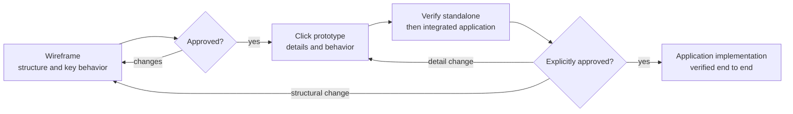

# UI/UX Design Workflow

Use this workflow for structure and behavior review before application
implementation, regardless of product domain or frontend framework. Paths,
roles, languages, viewport sizes and runtime helpers are project configuration,
not prerequisites of the workflow. Preserve an existing project's conventions
rather than introducing this repository's choices elsewhere.

In this repository, follow [ADR-0013](../../../docs/ADR/ADR-0013-wireframes-and-click-prototypes.md)
and the [design instructions](../../instructions/design.instructions.md).
The ADR owns decisions and approval policy; this skill owns the working procedure,
annotation examples and repository bindings. Keep artifact status and review
evidence in the design index, not in these reusable rules.

## Workflow Overview



## Explicit Approval Gates

Apply the project's approval policy, here [ADR-0013: Changes and approval](../../../docs/ADR/ADR-0013-wireframes-and-click-prototypes.md#changes-and-approval).
Before each dependent step, check the design index for explicit approval of its
current prerequisite revision. Present drafts and verification evidence for
review; when corrections are requested, update and verify the draft before
returning it for review. Wait without repeatedly prompting for approval or
continuing dependent work while review is pending.

## 1. Understand the change

1. Read the project's design index, the affected draw.io source, and the prototype. An existing PNG may show an older revision and is not the current draft.
2. Read the applicable decisions and requirements (for example, business rules, permissions, localization and accessibility). A design change must not invent business rules; ask when a policy is unclear.
3. Decide which artifacts change:

| Change | Wireframe | Prototype | Design system |
| --- | --- | --- | --- |
| New view | New source; PNG after approval | New page | Only if new patterns are needed |
| Layout, sections, navigation, new controls | Update | Update | — |
| Validation, states, texts, dialog details, interaction | Note only key behavior needed to review the view | Update | — |
| Colors, typography, spacing, component pattern | — | Update affected pages | Update tokens and guides |
| Shell (toolbar, navigation, user menu) | Shell wireframe | Shared shell implementation | If tokens change |

## 2. Wireframe

- Use one editable source per substantially different view layout, with one desktop main-content viewport at the project's agreed size. Keep shared shell chrome in its own wireframe. Expand the drawing around the viewport for annotations; do not enlarge the viewport merely to fit notes.
- Use one agreed review language consistently for UI labels, placeholders, annotations and connector labels unless explicitly asked otherwise. Wireframe review language does not replace the prototype's or application's localization requirements.
- For each annotation, ask whether the detail affects what users see or can do, or is needed to decide the layout. Keep only the key interaction or critical constraint needed for that review, stated briefly. Demonstrate detailed interactions, validation, errors and edge cases in the prototype; keep enduring business and security rules in their authoritative ADRs rather than relying on a wireframe or prototype as the specification. Do not discard requirements when shortening notes.
- Check whether the drawing already conveys the detail without a note. Omit or remove notes that merely describe visible elements, such as identifying a visible tab, even when those elements were just changed. Keep necessary behavior, scope, and constraints that are not apparent from the drawing.

### Annotation scopes

- Group conditional details under short, bold bracketed scope headers on their own lines, with the relevant detail below each header. Use adjacent brackets for attributes that must all apply: `[role: manager][state: retired]` means the detail applies only to managers viewing a retired item. Add further attributes the same way, for example `[role: manager][state: retired][device: phone]`. Do not split a combined condition across separate headers or use one bracket containing multiple attributes. Use separate sections when behavior differs; `[roles: manager, member]` denotes a shared detail for either listed role, not two simultaneous roles. Attribute names and values are examples, not a fixed product vocabulary. Put a blank line before a header when other text precedes it in the note; do not add one before the first line. General details need no scope header.

Example note (bold headers, with each detail below its header):

**[role: manager][state: retired]**<br>
Show the reactivation action.

**[role: manager][state: retired][device: phone]**<br>
Open confirmation full-screen.

### Drawing and review

- Style conventions: Calibri; panels and controls as plain boxes; primary actions green-filled; placeholders dashed. Enclose the viewport in a dashed border. Use yellow note shapes (`shape=note`, not callouts) for needed key behavior, states, roles, dialogs, and phone layout, entirely outside the viewport. Arrange notes around its edges with space between them. Connect each note to the relevant existing component with an arrow pointing from note to component; route through empty space where possible.
- In viewport UI, square-bracketed text such as `[delete]` represents an icon placeholder, not a literal UI label. This is separate from annotation scope headers.
- Keep the XML readable. If the user edited the source, change only the affected cells.
- Consolidate notes about the same area/component into one note with one arrow. Use straight connectors (`edgeStyle=none;curved=0`) with a 3px stroke (`strokeWidth=3`) and no intermediate waypoints.
- Use a black 3px viewport border with draw.io's "Dashed (1)" preset (`strokeColor=#000000;strokeWidth=3;dashed=1`, no custom `dashPattern`).
- Send the viewport rectangle to the back (first drawable cell in the XML root), keeping other elements in front. Use black (`strokeColor=#000000`) for annotation connector lines.
- Make new or changed annotations visually obvious during review instead of embedding revision labels such as "R5 draft" in comment text. Prefer a temporary light-blue note (`fillColor=#dae8fc;strokeColor=#6c8ebf`); optionally highlight its text or connector in blue (`#0078D4`). Use a consistent marker for the changed annotations only, keeping their text readable and preserving the user's positions and arrow routing. Keep revision/approval history in the design index, not the annotation prose.
- After explicit approval, inspect the approved source for remaining review colours. If the user has not reset them, restore the normal yellow note (`fillColor=#fff2cc;strokeColor=#d6b656`), black text (`fontColor=#000000`) and black connector (`strokeColor=#000000`), removing temporary inline text-colour overrides where necessary. Remove obsolete revision/draft prefixes from annotation prose without changing its meaning. Preserve all other user edits. This is approval housekeeping, not a new design revision or approval gate.
- Give notes an initial non-overlapping position outside the viewport, then ask the user to arrange them in draw.io. Offer all four sides, including top and bottom, to shorten arrows. Do not automatically optimize routes or overwrite their placement. After the user confirms the arrangement, present the current source for review; that confirmation is not approval.
- Do not export a PNG while creating, revising, or arranging a draft, including when adding review markers. Review the current `.drawio` source in draw.io instead. Identify any existing PNG as potentially stale rather than presenting it as the draft. Check the source for concise, review-relevant notes that do not merely restate the drawing, consistent use of the agreed review language, the dashed viewport, external note placement, readable text, one arrow per annotated area, and absence of annotation/control overlap. Report any checks that cannot be performed.
- Only after explicit approval of the current source and review-marker cleanup, export the preview with the draw.io desktop app:

```text
<drawio-executable> -x -f png -b 10 -o <view>-wireframe.png <view>-wireframe.drawio
```

- View the exported PNG and verify that it reflects the cleaned approved source, including the viewport and external notes. Do not record cleanup as complete or advance to the prototype if export or inspection is blocked. If inspection reveals a design flaw requiring a source change, correct the draft and return the new revision for explicit approval.

## 3. Click prototype

- Build an offline prototype from the approved wireframe using shared shell,
  components, formatting and fictional data. Keep assets local and reuse the
  project's runtime helpers rather than inventing parallel implementations.
- Maintain an integrated application entry that composes the existing views,
  not a specimen gallery. Keep standalone views usable, the directly opened
  shell neutral, and avoid duplicate chrome. Preserve role, language, theme and
  fictional data through actual navigation. Keep implementation notes separate
  from the review surface.
- Demonstrate loading, empty, error/retry, validation, submitting, success and
  failure with retained input where applicable. Cover relevant permissions,
  languages, themes and responsive layouts using the project's design tokens.
- Prototypes illustrate behavior; they do not enforce security or define new
  business rules.

## 4. Design system

- Change shared tokens rather than duplicating color or size literals. Include
  all supported themes and document contrast for new color pairs.
- Pair status with icon and text cues; retain visible focus and accessible names.
- Update the relevant component/typography guides and specimens when a shared
  primitive changes.

## 5. Verify

Check the focused standalone prototype first, then the integrated application
entry through actual navigation. Exercise changed flows, owning-view dialogs,
shell context, relevant roles, languages, themes, states and desktop/phone widths.
Check keyboard and focus behavior, overflow and console errors.

Record standalone and integrated evidence separately, including viewport and
settings. Standalone success alone is insufficient; report blocked integration
instead of claiming full verification. Successful checks are not design approval.

## 6. Finish

- Update the project's design index with links and draft status for changed references.
- Record each explicit approval against its artifact and reviewed revision, with the approval date; preserve earlier approvals as history. Complete the wireframe cleanup/export procedure above without a separate request. Report pending work.
- Summarize changes and actual verification; list open business questions rather than deciding them in the design.
- Implement only after the required approvals, following the project's application and testing conventions.
- If either artifact is still a draft, state what awaits review. Do not infer approval from feedback or a general instruction to continue.

## Repository Integration: POCKET MONkEY

These bindings apply here, not to other projects adopting the workflow:

- Design index: [docs/design/README.md](../../../docs/design/README.md).
- Wireframes: `docs/design/wireframes/<view>/<view>-wireframe.drawio` and the matching approved PNG; desktop viewport width 1440px.
- Wireframe review language: English unless explicitly requested otherwise. Prototypes and application: German and English.
- Supported roles: Manager and Member; themes: light and dark. Verify desktop and 360px phone widths, including read-only Member behavior where applicable. Phone styles use `@media (max-width: 599px)`.
- Integrated entry: `docs/design/prototypes/index.html`; shared runtime: `docs/design/prototypes/shared/`.
- Tokens: `docs/design/design-system/styles/*.css`; document contrast in `color-scheme.md` and patterns in `components.md` or `typography.md`.
- Application implementation: Angular, following the [web instructions](../../instructions/web.instructions.md) and [ADR-0005](../../../docs/ADR/ADR-0005-e2e-first-verification.md).
- Windows draw.io executable: `C:\Program Files\draw.io\draw.io.exe`.

- Page skeleton: `docs/design/prototypes/<view>/index.html` with `<div id="view">`, then `../shared/data.js`, `../shared/prototype.js`, and an inline script calling `PM.init`.

```js
PM.init({
  active: 'overview',            // navigation entry; omit for none
  title: 'pageTitleKey',
  states: ['normal', 'loading', 'error'], // optional review states
  render,                        // re-run on every language, theme, role, or data change
  strings: { en: { /* … */ }, de: { /* … */ } }
});
```

- Runtime helpers in `shared/prototype.js`:

| Helper | Purpose |
| --- | --- |
| `PM.t(key, params)` | Translated text; `{name}` placeholders |
| `PM.money(minor)` / `PM.amountHtml(minor)` | Signed, colored amount from integer cents |
| `PM.parseAmount(text, { signed })` | Exact two-decimal input to cents, or `null` |
| `PM.date(iso, withTime)` | Business-timezone date formatting for the language |
| `PM.dialog({ title, body, footer, dismissible })` | Modal dialog with focus return |
| `PM.fieldError(input, message)` | Accessible field error |
| `PM.request()` | Simulated save; honors "Next save fails" |
| `PM.toast(text, tone)` | Supplementary confirmation |
| `PM.data`, `PM.saveData()` | Fictional data in local storage |
| `PM.isManager()`, `PM.currentUser()` | Role-dependent rendering |

- Use `PM.t`, `PM.money` and `PM.date` rather than hard-coding translated strings, amounts, currency or dates. Amounts are always signed: positive green, negative red, zero standard text.
- Verify simulated save failures with "Next save fails" and the available review states.

The integrated browser tab may be hidden: prefer `page.evaluate` with `requestSubmit()`/`click()` or `force: true` clicks, and disable the cache (`Network.setCacheDisabled`) so edited `file://` scripts reload.
