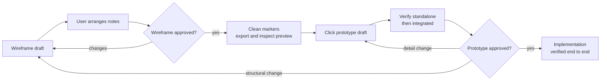

# UI/UX Design Workflow

A reusable workflow for reviewing structure and behavior before application
implementation, independent of product domain and frontend framework. Each
project supplies a profile with its paths, roles, languages, viewports, tools
and runtime helpers.

## Before You Start

1. Load the project profile from `references/` or the project's design
   documentation. Here: [POCKET MONkEY](references/pocket-monkey.md).
   If none exists, follow [Set up a project](#set-up-a-project).
2. Read the project's decision records and design index named in the profile.
   Project decisions override the profile; the profile overrides the defaults
   in this skill ([precedence](references/project-profile.md#precedence)).
3. Preserve existing conventions and user edits; do not import another
   project's choices.

## Choose the Path

| Request | Go to |
| --- | --- |
| New view or structural change | [Understand](#1-understand-the-change), [Wireframe](#2-wireframe) |
| Revise wireframe notes | [Wireframe](#2-wireframe), [annotation scopes](#annotation-scopes) |
| Notes arranged by the user | Run [source checks](references/drawio-conventions.md#source-checks); present the source for review |
| Wireframe approved | [Cleanup and export](#drawing-and-review), then [record approval](#6-finish) |
| Interaction, state or text detail | [Click prototype](#3-click-prototype), [Verify](#5-verify) |
| Prototype approved | [Record approval](#6-finish); hand off for implementation |
| Color, typography, spacing or component pattern | [Design system](#4-design-system), [Verify](#5-verify) |
| No design setup or profile yet | [Set up a project](#set-up-a-project) |

## Workflow Overview



Artifact status: `draft` → `in review` → `approved`. Any change to an approved
artifact returns it to `draft`.

## Explicit Approval Gates

Default rules; a project's decision records may strengthen or override them.

- Only explicit user approval of a named artifact's current revision counts.
  Feedback, requested corrections, arrangement confirmation, policy acceptance,
  "proceed" and passing checks are not approval.
- Earlier approvals remain history and never carry over to a changed revision.
- Require wireframe approval and its cleaned, inspected preview before the
  prototype, and prototype approval before implementation. Both named current
  artifacts may be approved together.
- Before each dependent step, check the design index for the prerequisite's
  approval. Present drafts with verification evidence. After corrections,
  verify and return the draft; do not repeatedly prompt for approval or continue
  dependent work while review is pending.

## Set up a project

1. Detect existing design artifacts, decision records, tokens, prototype runtime
   and implementation conventions.
2. Create a profile from the [profile template](references/project-profile.md#profile-template).
   Ask for business-relevant values such as roles, languages and approval rules;
   never invent them.
3. Create a design index with the [required fields](references/project-profile.md#design-index-fields).
4. Start wireframes from the [template](assets/wireframe-template.drawio).
5. Create a minimal offline prototype runtime and tokens only when the requested
   work needs them.
6. Link the profile from the project's agent instructions.

## 1. Understand the change

1. Read the design index, the affected editable source and the prototype. An existing preview may show an older revision and is not the current draft.
2. Read the applicable decisions and requirements (business rules, permissions, localization, accessibility). Do not invent business rules; ask when a policy is unclear.
3. Decide which artifacts change:

| Change | Wireframe | Prototype | Design system |
| --- | --- | --- | --- |
| New view | New source; PNG after approval | New page | Only if new patterns are needed |
| Layout, sections, navigation, new controls | Update | Update | — |
| Validation, states, texts, dialog details, interaction | Note only key behavior needed to review the view | Update | — |
| Colors, typography, spacing, component pattern | — | Update affected pages | Update tokens and guides |
| Shell (toolbar, navigation, user menu) | Shell wireframe | Shared shell implementation | If tokens change |

## 2. Wireframe

- Use one editable source per substantially different view layout, with one desktop main-content viewport at the profile's width. Keep shared shell chrome in its own wireframe. Start from the [template](assets/wireframe-template.drawio) and follow the [draw.io conventions](references/drawio-conventions.md) unless the profile overrides them.
- Write all wireframe text in English, including UI labels, placeholders, notes and connector labels. Product localization applies to prototypes and the application, not wireframes.
- For each note, ask whether the detail affects what users see or can do, or is needed to decide the layout. Keep only that key behavior or critical constraint, briefly. Detailed interactions, validation, errors and edge cases belong in the prototype; enduring business and security rules belong in authoritative decisions. Do not discard requirements when shortening notes.
- Omit notes that merely describe what the drawing already shows, such as a visible tab, even after a change.

### Annotation scopes

- Put conditional details under short, bold bracketed scope headers on their own lines, with the detail below.
- Adjacent brackets mean every condition must apply: `[role: manager][state: retired]` applies only to managers viewing a retired item. Add more conditions the same way, such as `[role: manager][state: retired][device: phone]`.
- Write attributes in the profile's order (default: role, state, device or viewport). Do not split one combined condition across headers or put several attributes in one bracket.
- Use separate sections for differing behavior. `[roles: manager, member]` marks a detail shared by either listed role, not both at once.
- Use the profile's scope vocabulary; names and values here are examples.
- Put an empty line before a header that follows other text, not before the first line. General details need no header.

Example note:

**[role: manager][state: retired]**<br>
Show the reactivation action.

**[role: manager][state: retired][device: phone]**<br>
Open confirmation full-screen.

### Drawing and review

- Consolidate notes about one area into one note with one arrow. In user-edited sources, change only affected cells.
- Mark new or changed notes with the [review marker](references/drawio-conventions.md#review-markers) instead of revision labels in their text.
- Give notes an initial non-overlapping position outside the viewport, then ask the user to arrange them in the editor, on any side. Do not optimize or overwrite their placement. Arrangement confirmation is not approval.
- Review the editable source, never a preview, while the wireframe is a draft. Do not export during creation, revision or arrangement; identify any existing preview as potentially stale. Run the [source checks](references/drawio-conventions.md#source-checks) before presenting the draft.
- After explicit approval, apply the [cleanup](references/drawio-conventions.md#cleanup-after-approval), then [export](references/drawio-conventions.md#export) and view the preview without waiting for a separate request.
- Do not record cleanup as complete or advance to the prototype if export or inspection is blocked. If inspection reveals a design flaw, correct the source and return the new revision for approval.

## 3. Click prototype

- Build an offline prototype from the approved wireframe using the profile's shared shell, components, formatting helpers, tokens and fictional data. Keep assets local; reuse existing helpers rather than creating parallel ones.
- Maintain an integrated application entry that composes the existing views, not a specimen gallery. Keep standalone views usable, the directly opened shell neutral and chrome unduplicated. Preserve role, language, theme and fictional data through actual navigation. Keep implementation notes outside the review surface.
- Demonstrate loading, empty, error/retry, validation, submitting, success and failure with retained input where applicable, plus the profile's permissions, languages, themes and breakpoints.
- Prototypes illustrate behavior; they do not enforce security or define business rules.

## 4. Design system

- Change shared tokens rather than adding color or size literals. Provide values for every supported theme and document contrast for new color pairs.
- Pair status with icon and text cues; keep visible focus and accessible names.
- Update component/typography guides and specimens when a shared primitive changes.

## 5. Verify

Check the focused standalone prototype first, then the integrated entry through
actual navigation. Exercise changed flows, owning-view dialogs, shell context and
the profile's matrix of roles, languages, themes, states and breakpoints. Check
keyboard and focus behavior, overflow and console errors.

Record evidence separately for standalone and integrated checks. Standalone
success alone is insufficient; report blocked checks rather than claiming full
verification. Passing checks are not design approval.

```markdown
| Scope | Role | Language | Theme | Viewport | States/flows | Result |
| --- | --- | --- | --- | --- | --- | --- |
| Standalone | <role> | <lang> | <theme> | <width> | <checked> | pass / fail / blocked: <reason> |
| Integrated | <role> | <lang> | <theme> | <width> | <checked> | pass / fail / blocked: <reason> |
```

## 6. Finish

- Update the design index with links, revision and status for changed artifacts.
- Record each explicit approval against its artifact and reviewed revision, with date and the user's wording; keep earlier approvals as history. Complete wireframe cleanup/export without a separate request. Report pending work.
- Summarize changes and actual verification; list open business questions rather than deciding them in the design.
- If an artifact is still a draft, state what awaits review. Do not infer approval from feedback or a general instruction to continue.
- After both approvals, hand off implementation with the approved revisions, open questions and the states and flows that need application tests. Follow the profile's implementation and verification conventions.

## Project Profiles

- Contract and template: [project-profile.md](references/project-profile.md).
- Wireframe defaults: [drawio-conventions.md](references/drawio-conventions.md).
- This repository: [POCKET MONkEY profile](references/pocket-monkey.md).
