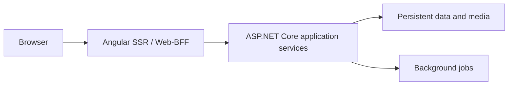

# ADR-0002 Application Boundaries

_Creation date_: 2026-10-04

## Context

POCKET MONkEY provides a browser-based pocket-money application. Rendering needs
must not determine authorization or financial correctness, and the frontend and
backend should have explicit responsibilities without requiring a distributed
microservice architecture.

## Decision

- Use Angular SSR with Taiga UI and locally packaged Lucide icon fonts/assets for the web interface and Web-BFF.
- Use ASP.NET Core application services for business rules, authorization, persistence, and background jobs. Keep financial mutations out of Angular components and SSR handlers.
- Connect the Web-BFF and backend through explicit HTTP contracts. Backend authorization applies equally to browser requests and SSR data reads.
- Keep frontend request identity/language isolated and private responses out of shared caches. Credentials and backend-only configuration must not enter browser bundles or hydration data.
- Keep domain/application behavior independent of hosting and storage SDKs. Choose concrete persistence and process-hosting mechanisms through separate decisions when evaluated.
- Use exact monetary arithmetic, atomic ledger/balance writes, and idempotency for retried mutations/jobs; agree on precision and business policies before implementing financial behavior.

