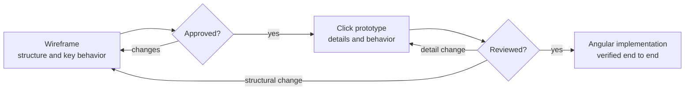

# ADR-0013 Wireframes and Click Prototypes

_Creation date_: 2026-10-10

## Context

POCKET MONkEY needs deliberately designed views before features are implemented
in the Angular application. Contributors and coding agents need a shared way to
agree on structure and behavior that is quick to change, reviewable without the
running application, and does not tie every view to the current application shell.

Static images alone hide behavior such as validation, dialogs, roles, languages,
and phone layouts; a fully specified wireframe for every state becomes hard to
maintain. The design must still respect the backend-owned business rules and the
German/English, accessibility, and local-asset requirements of the product.

## Decision

Design work for a view follows two steps: a rough wireframe, then a detailed
click prototype. Both live under [docs/design](../design/README.md) and are
reviewed before the Angular implementation.

### Wireframes

- Create one editable draw.io source per view in `docs/design/wireframes/<view>/<view>-wireframe.drawio` with a synchronized `<view>-wireframe.png` preview.
- Draw one main desktop viewport per view, enclosed by a dashed border. Describe important behavior, states, role differences, dialogs, and phone layout in note shapes outside that border, connected by arrows to the relevant component. Keep annotations off the UI and on the same drawing rather than adding pages per state.
- Show only the view inside the shell's main content container. The application shell has its own wireframe, so it can change without updating every view.
- Create a separate source only when a screen has its own substantial layout, such as separate tabs of one view.
- Keep wireframes rough: they define structure, hierarchy, and key interactions, not colors, typography, or exact spacing.
- Consolidate annotations for the same area into one note and arrow. After the initial wireframe is created or substantially updated, ask the user to arrange the external notes in draw.io, using any side of the viewport for readable, short connectors. Preserve that arrangement, then export and review the synchronized preview after confirmation.

Annotation format refined with user approval on 2026-10-10: external notes and
component-directed arrows replace the original in-viewport callouts. The
wireframe/prototype approval workflow is unchanged.

Annotation workflow refined with user approval on 2026-10-10: the assistant
prepares consolidated note content; the user arranges notes before final export
and review. This replaces automatic annotation-layout optimization, not the
wireframe/prototype approval gates.

### Click prototypes

- Build one offline click prototype per view in `docs/design/prototypes/<view>/index.html`, based on the approved wireframe.
- Share the application shell, common components, formatting, and fictional data in `docs/design/prototypes/shared/`. Views render only their main content.
- Use the design-system tokens, bundled fonts, and local images. Prototypes must work from the file system without a server or internet access.
- Show the details and behavior the wireframe only outlines: validation, loading/empty/error states, submitting and retry, dialogs, confirmations, Manager/Member differences, German and English text, light/dark themes, and phone layouts.
- Prototypes illustrate behavior; they are not production code, enforce no security, and use only fictional data.

### Changes and approval

- Change structure in the wireframe first and then the prototype; change details or behavior in the prototype only.
- Record approval per reference in the design index. Approved references guide the implementation but do not override ADRs, backend authorization, or exact money rules, and do not create business rules on their own.
- Implement approved views in the Angular application using the design-system tokens and verify them as described in [ADR-0005](ADR-0005-e2e-first-verification.md).
